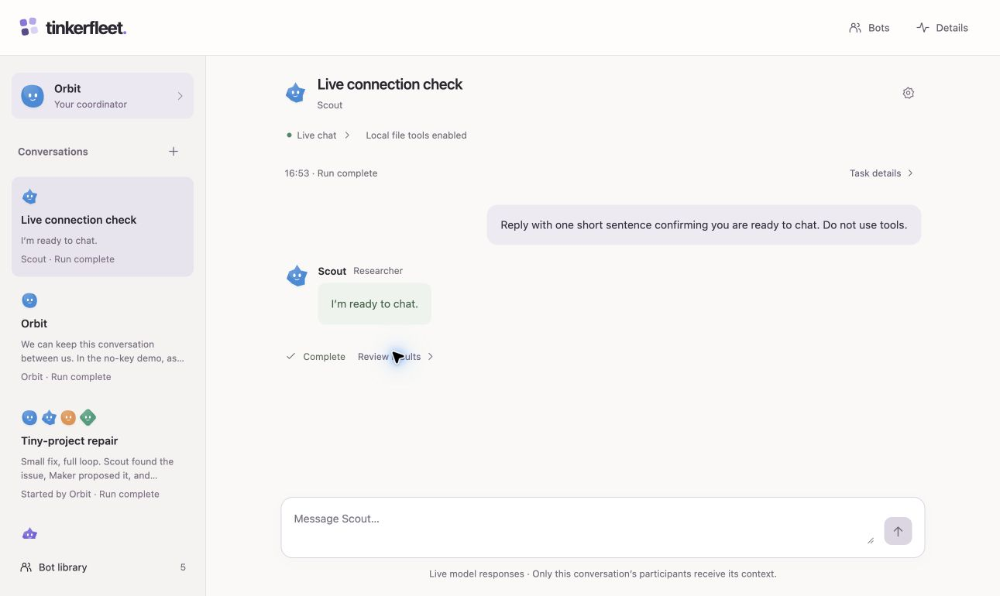

# Tinkerfleet

**A small multi-agent workspace, explained from the ground up.**

Tinkerfleet is a runnable, deliberately small companion to Gary Morris's
[Tinkerloop](https://github.com/garyamorris/tinkerloop). Tinkerloop makes a coding
agent's model/tool loop visible. Tinkerfleet adds reusable bot personas, direct
and group conversations, human approvals, and an optional local command runner.

Start with the no-key demo. Then read six runnable lessons. Finally, inspect the
real [OpenAI Agents SDK](https://openai.github.io/openai-agents-js/) integration.
Basic TypeScript is enough; previous agent-building experience is not required.

See [the build handover](HANDOVER.txt) for verified checks and remaining integration work.

## A look inside



[Mobile view](docs/screenshots/native-live-mobile.jpg). Captured at 1291 × 770
on desktop and 390 × 844 on mobile. The Scout response came from one real
conversation-only model call and survived restart. The displayed server now has
local tools enabled; that response did not use them. Native edits and commands
were verified separately with offline tests in temporary folders, not a live agent.

## Try it without a key

You need **Node.js 24+** and npm. From this repository:

```sh
npm ci
npm run dev
```

Open **http://localhost:4317**. The default is **Demo** mode: a deterministic,
scripted teaching simulation. It makes **no model calls**, spends **no API tokens**,
and does **not execute commands**. An approval in the demo advances the scripted
example; its test output is explicitly simulated, not evidence of execution.

Tell the primary Coordinator what you want to accomplish. For the demo, ask it
to fix the failing tests in tiny-project: the scripted Coordinator starts a group
for that known fixture. A simple greeting stays in the primary conversation.
Visit the created group to review the edit and command proposals. Deny one to
see that branch, or approve each exact action to finish the simulated walkthrough.
You can also visit individual bots directly. There is no manual group-start
chooser; the Coordinator selects specialists and creates the group.

The included [practice project](examples/tiny-project) contains a deliberate
addition bug. Its own tests fail until you fix it; this is separate from the
repository's test suite.

## What you learn

| Lesson | Building block | Run |
| --- | --- | --- |
| [1. The coordinator](lessons/README.md#1-the-coordinator) | Instructions and an explicit owner of the task | `npm run lesson:1` |
| [2. Specialists as tools](lessons/README.md#2-specialists-as-tools) | Delegate work without surrendering coordination | `npm run lesson:2` |
| [3. Tool contracts](lessons/README.md#3-tool-contracts) | Validate requests before touching data | `npm run lesson:3` |
| [4. Human approvals](lessons/README.md#4-human-approvals) | Bind permission to one exact action | `npm run lesson:4` |
| [5. Local tools](lessons/README.md#5-local-tools) | Inspect local execution and approval boundaries | `npm run lesson:5` |
| [6. The selected workspace](lessons/README.md#6-the-selected-workspace) | Understand real files and selected-folder scope | `npm run lesson:6` |

Every lesson runs without an API key or Docker. Assertions make the expected
behavior executable. They teach the real building blocks without pretending a
scripted answer came from a model. The [lesson guide](lessons/README.md) includes
exercises and a reading order.

## Read the implementation

Follow one task from the interface to the boundary:

1. [`src/client/main.tsx`](src/client/main.tsx) renders the conversation and decisions.
2. [`src/server/http.ts`](src/server/http.ts) handles the local HTTP interface.
3. [`src/server/demo.ts`](src/server/demo.ts) provides the scripted teaching path.
4. [`src/server/sdk.ts`](src/server/sdk.ts) defines the live coordinator and specialists.
5. [`src/server/approval.ts`](src/server/approval.ts) binds decisions to exact actions.
6. [`src/server/native-runner.ts`](src/server/native-runner.ts) prepares local file and command actions.

Start with the demo and lessons before the larger SDK and runner modules. Compare
the same approval concept across a lesson, its tests, and the browser interface.

## Four visible jobs

With workspace tools enabled, the roles divide the work as follows:

- **Coordinator** owns the user's task, calls specialists, and assembles the answer.
- **Scout** reads the selected workspace and reports what it finds.
- **Maker** proposes edits; applying one requires human approval.
- **Checker** proposes a command; executing it requires human approval and the
  local runner.

The interface calls the specialist roles Researcher, Builder, and Reviewer.
Scout, Maker, and Checker are their default profile names and SDK role identities.
Builder and Reviewer both have approval-gated edit and command tools; their
instructions give them different focuses.

In live mode, a direct chat invokes the selected SDK agent. Only a direct
Coordinator has `start_group_conversation`: it can choose one to three
specialists from its captured roster and start one group per run. The group
includes that Coordinator and delegates only to its selected specialists through
`agent.asTool(...)`. Groups cannot create more groups. Tools, validation,
approvals, and execution remain server-owned.

## Bots, conversations, and runs

| Concept | What it means |
| --- | --- |
| **Bot persona** | A reusable profile: name, purpose, role, color, and avatar shape |
| **Conversation** | A named direct or group chat with participants, history, and a draft |
| **Run** | One submitted task within a conversation, with its own approvals, results, and local actions |

Create multiple independent conversations with the same bot when you want
separate topics. New groups are Coordinator-created: the Coordinator plus one
to three specialists with distinct roles—Researcher (`scout`), Builder (`maker`),
and Reviewer (`checker`). Existing groups and histories remain accessible.
A persona's purpose guides its live SDK instructions within its fixed role; it
cannot add tools or bypass approvals. Appearance remains cosmetic. Demo mode
stays scripted regardless of a profile's purpose.

The sidebar lists chats by name with a preview and status. Reload returns to the
active chat. Local conversation history survives server restart, but unfinished
work is cancelled and its pending approvals are denied. Workspace-enabled runs use the real selected folder. Chats keep separate
conversation context but can observe each other's file changes when they use
that folder. Saved history does not restore execution authority.

The Coordinator shares a bounded task brief with a new group, not the private
source chat's history. That group starts an independent run attributed to the
Coordinator. The source and group are separate SDK runs with separate per-run
budgets, so one user turn can consume two run budgets. Stopping the primary does
not stop a group already created; stop that group explicitly. These limits are
not an overall monetary cap. This is explicit delegation, not cross-chat memory.

Creating a conversation captures its participant profiles. Library edits apply
to new conversations, leaving existing chats and runs unchanged. Profile
preferences live in browser storage. The server stores conversation
views in the private, Git-ignored `.tinkerfleet/conversations.json` file. These
views can contain prompts, messages, drafts, and artifact text; treat them as
private data. Read the [interface guide](docs/interface.md) and
[privacy details](docs/setup.md) before using real content.

## Optional live mode

Live mode uses real OpenAI model calls and can incur API charges. Its default
is **conversation-only**: direct chats and Coordinator-created groups work
without Docker. Workspace tools are disabled, so the app does not read a host
project or expose file-read, edit, or command tools to the model. Read
[setup and privacy](docs/setup.md) and the [threat model](SECURITY.md) first.
You deliberately opt in with `TINKERFLEET_MODE=live`, provide your own
server-side `OPENAI_API_KEY`, and set `TINKERFLEET_MODEL` to a tool-capable model
available to your account. There is no hard-coded model recommendation.

The app uses the official **`@openai/agents` 0.20.0** TypeScript SDK.
This SDK is a library running in the local server. It is not a managed Agents API
session, and it does not itself sandbox tool functions.
[See the API / SDK / managed service distinction](docs/architecture.md#api-sdk-and-managed-service).

To enable local workspace tools, explicitly set:

```dotenv
TINKERFLEET_WORKSPACE_TOOLS=1
TINKERFLEET_WORKSPACE=/absolute/path/to/your/practice-project
```

**Approved edits change real files. Approved commands run locally with your user's
permissions.** The working directory is not a security sandbox; project code can
access broader resources allowed to your account. Commands use no shell, receive
a minimal environment without inherited server secrets, and have time/output
bounds. Use a trusted practice folder and review each exact action. Docker is not
part of the active application. See [setup](docs/setup.md) and [SECURITY.md](SECURITY.md).

## Find your way around

- [Architecture walkthrough](docs/architecture.md): data flow and trust boundaries
- [Setup and privacy](docs/setup.md): demo, real model chat, and optional local tools
- [Approvals](docs/approvals.md): pause, review, approve or deny, then resume
- [Local workspace tools](docs/workspace.md): real edits, local commands, and their limits
- [Interface tour](docs/interface.md): conversation, reusable profiles, and run details
- [Extending Tinkerfleet](docs/extending.md): add a narrow capability safely
- [Troubleshooting](docs/troubleshooting.md)
- [Security policy and threat model](SECURITY.md)
- [Contributing](CONTRIBUTING.md)

## Check your changes

```sh
npm run check
npm run lesson:1
npm run lesson:2
npm run lesson:3
npm run lesson:4
npm run lesson:5
npm run lesson:6
```

The core checks and lessons need no credentials and make no paid API calls.
Browser verification is separate from `npm run check`; see the handover for its
current status.
Native execution tests use temporary fixtures. Passing tests do not prove a
model-selected command is safe; live provider integration requires separate
validation.

## Deliberately small

This is an educational local application, not a production multi-tenant service.
Conversation history and real file changes persist. SDK execution state and
approval authority do not survive a server restart.
It has no unattended background workers, remote desktop control, production
identity provider, or OS sandbox. With workspace tools enabled, approved changes
are applied to the selected source folder.

Original Tinkerfleet UI and avatars; no third-party product screenshots or assets
are bundled. Inspired by Tinkerloop's learning-by-building approach, with a
different implementation and scope. MIT licensed; see [LICENSE](LICENSE).
