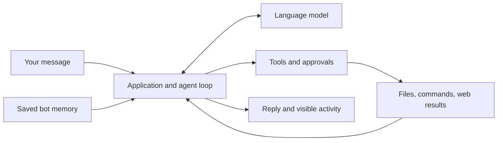
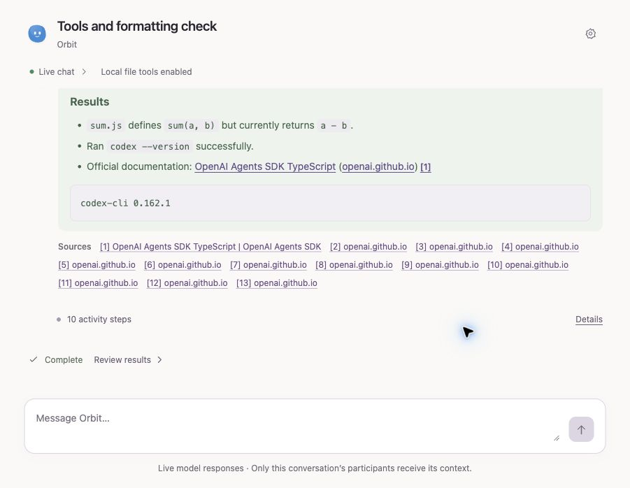
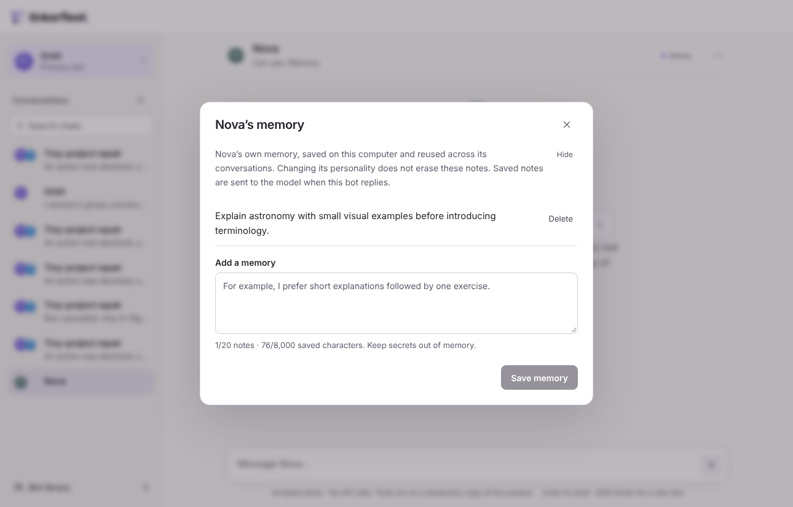

# Tinkerfleet

**Learn how to build a personal agent application by exploring one that works.**

Tinkerfleet is a small, open-source app where you talk to a primary agent, create
other agents with their own personalities, and give them tools and memory. In
live mode they can research the web, read a project, propose file changes, and
run commands on your computer after approval.

If you have used an agent tool and wondered **“How would I build something like
this?”**, this repository is for you. The app, lessons, and documentation explain
the pieces behind the experience: a model loop, tool functions, conversations,
coordination, persistent memory, and a browser interface.

You do not need previous experience building agents. Familiarity with JavaScript
or TypeScript, JSON, and a terminal will help. Start without an API key; connect a
real model when you are ready.

## Start with something you can see

You need Node.js 24 or later and npm.

```sh
git clone https://github.com/garyamorris/tinkerfleet.git
cd tinkerfleet
npm ci
npm run dev
```

Open **http://localhost:4317**. The default demo is scripted and makes no model
calls, web searches, project edits, or command executions. It does save your bot
profiles, chats, and memory notes locally, so you can explore the actual interface.

Try this short tour:

1. Start a conversation with **Orbit**, the primary agent.
2. Say **“Create a patient astronomy tutor called Nova.”**
3. Choose **Open this bot’s chat** to speak with Nova directly.
4. Open **Bot library → Memory** beside Nova and save a sample preference.
5. Return to Orbit and ask **“Fix the failing tests in tiny-project.”** Open the
   group it creates and inspect the simulated edit and command approvals.

The demo recognizes a few teaching examples; it does not understand arbitrary
requests. Its purpose is to let you see the interaction before paying for a model.
The [interface tour](docs/interface.md) explains each step. Use the
[setup guide](docs/setup.md) when you want live replies.

## What you are building

An agent app connects a model to functions that can do useful work. The model
chooses a next step; your application decides which functions exist, runs them,
and gives their results back to the model.



Tinkerfleet makes that loop visible. You can inspect what was requested, what
needed approval, what actually ran, and what result came back. The
[architecture walkthrough](docs/architecture.md) follows a message through the code.

| Capability | What it teaches |
| --- | --- |
| A primary agent and individual agents | Coordination is application logic; each bot is a separate identity with instructions |
| Agent creation and direct chats | Turn a model’s structured request into a saved profile and a usable conversation |
| Messages and primary-created groups | Delegate a defined task without copying an entire private conversation |
| File and command tools | Connect model output to real functions and local processes |
| Human approvals | Pause work, review the exact action, and resume it once |
| Public web research and sources | Combine provider-hosted tools with your local tools |
| Each bot’s own memory | Store useful facts and include them in later requests |
| Markdown replies and tool activity | Turn agent execution into an understandable interface |

See [capabilities and current limits](docs/capabilities.md) for what each mode
supports. Scout, Maker, and Checker are starter personalities; ordinary agents
share the enabled tools. Changing a bot’s name or avatar does not change its permissions.

## Choose your learning path

| You want to… | Start here |
| --- | --- |
| Understand how to build an app like this | [Build an agent app, step by step](docs/build-an-agent-app.md) |
| Learn by running small programs | [Six executable lessons](lessons/README.md) |
| Follow the complete application | [Architecture and data flow](docs/architecture.md) |
| Understand tools and real computer access | [Workspace tools](docs/workspace.md) and [approvals](docs/approvals.md) |
| Add lasting memory | [How bot memory works](docs/memory.md) |
| Make your own version | [Extend Tinkerfleet](docs/extending.md) |
| Check whether your changes work | [Testing an agent application](docs/testing.md) |

For a first pass, follow the build guide and run lessons 1–6 in order. Each
lesson uses real application code, explains one idea, and includes an experiment.
All six run without a model call. The later native-tool lessons use temporary
files and short local commands to demonstrate actual execution.

## Find the code behind the idea

| Part | Start reading |
| --- | --- |
| Chat UI, profiles, and approval cards | [`src/client/main.tsx`](src/client/main.tsx) |
| HTTP routes and conversation coordination | [`src/server/app.ts`](src/server/app.ts) |
| Agents, tool definitions, model loop, and SDK events | [`src/server/sdk.ts`](src/server/sdk.ts) |
| Scripted demo behavior | [`src/server/demo.ts`](src/server/demo.ts) |
| Conversation history and restart behavior | [`src/server/conversations.ts`](src/server/conversations.ts) |
| Saved facts for each bot | [`src/server/memory.ts`](src/server/memory.ts) |
| Exact-action decisions | [`src/server/approval.ts`](src/server/approval.ts) |
| Local files and processes | [`src/server/native-runner.ts`](src/server/native-runner.ts) |

The stack is TypeScript, React, Node.js, and the OpenAI Agents SDK. The SDK runs
inside the local Node server; live model inference happens through the OpenAI
API. Local tools use your computer directly. Docker is not part of this app.

## See the result



This capture is from a real model run that read a file, ran an approved version
command, and used hosted web search. [View its activity](docs/screenshots/tool-activity-live.jpg).



The memory capture uses the no-key demo and sample facts. Its conversation is
scripted; its saved notes are real local data. [Mobile view](docs/screenshots/bot-memory-mobile.png).

## Keep the important distinctions clear

Live file edits and commands can change your computer. Commands run with your
user’s permissions, and selecting a working folder does not create a sandbox.
Live requests can send conversation context, saved memories, and tool results to
the model provider. These are useful design decisions to understand when building
your own agent app; [the execution and data boundaries](SECURITY.md) explain them.

There is no fixed turn or model-call count limit by default. Token and runtime
budgets remain, and each local command currently has a 15-second timeout. This
small teaching implementation is therefore best suited to short experiments;
long coding jobs need a different command lifecycle. The
[capability guide](docs/capabilities.md) separates what works today from extension ideas.

## Continue learning

- [Setup](docs/setup.md) · [Troubleshooting](docs/troubleshooting.md)
- [Contribute a teaching improvement](CONTRIBUTING.md)
- [Tinkerloop](https://github.com/garyamorris/tinkerloop), a companion project focused on a coding agent’s model/tool loop
- [MIT license](LICENSE)

Start with one agent and one useful tool. Add the next piece when you can explain
what the current piece does.
