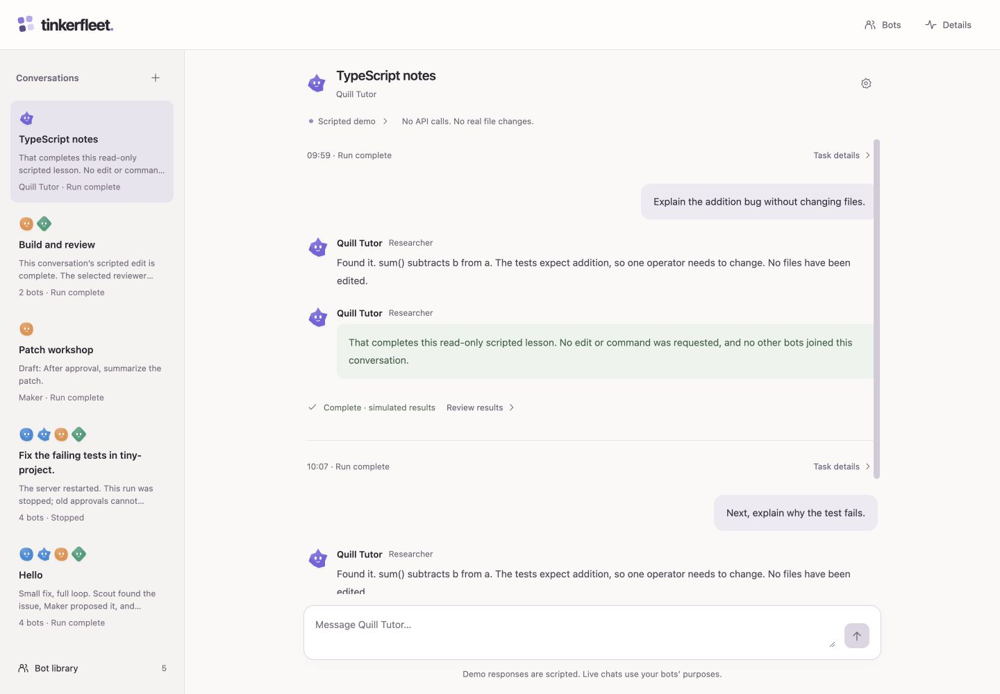

# Tinkerfleet

**A small multi-agent workspace, explained from the ground up.**

Tinkerfleet is a runnable, deliberately small companion to Gary Morris's
[Tinkerloop](https://github.com/garyamorris/tinkerloop). Tinkerloop makes a coding
agent's model/tool loop visible. Tinkerfleet adds reusable bot personas, direct
and group conversations, human approvals, and an isolated command runner.

Start with the no-key demo. Then read six runnable lessons. Finally, inspect the
real [OpenAI Agents SDK](https://openai.github.io/openai-agents-js/) integration.
Basic TypeScript is enough; previous agent-building experience is not required.

See [the build handover](HANDOVER.txt) for verified checks and remaining integration work.

## A look inside



Actual no-key demo captures: [group conversation](docs/screenshots/group-conversation.jpg),
[new conversation](docs/screenshots/new-conversation.jpg),
[mobile conversations](docs/screenshots/mobile-conversations.jpg), and
[mobile approval](docs/screenshots/mobile-approval.jpg).
The mobile checks used a 390 × 844 viewport. Demo completion and output are
simulated; these screenshots do not show live model or Docker execution.

## Try it without a key

You need **Node.js 24+** and npm. From this repository:

```sh
npm ci
npm run dev
```

Open **http://localhost:4317**. The default is **Demo** mode: a deterministic,
scripted teaching simulation. It makes **no model calls**, spends **no API tokens**,
and does **not run Docker commands**. An approval in the demo advances the scripted
example; its test output is explicitly simulated, not evidence of execution.

Create a direct conversation with one bot, or a group with the roles you need.
Try the tiny-project walkthrough, inspect an edit proposal, deny it once, then
start again and approve it. Open **Details** to inspect activity, output, and
changes for the selected conversation. The demo follows a scripted scenario
adapted to its participants; it does not answer arbitrary tasks.

The included [practice project](examples/tiny-project) contains a deliberate
addition bug. Its own tests fail until you fix it; this is separate from the
repository's test suite.

## What you learn

| Lesson | Building block | Run |
| --- | --- | --- |
| [1. The coordinator](lessons/README.md#1-the-coordinator) | Instructions and an explicit owner of the task | `npm run lesson:1` |
| [2. Specialists as tools](lessons/README.md#2-specialists-as-tools) | Delegate work without surrendering coordination | `npm run lesson:2` |
| [3. Tool contracts](lessons/README.md#3-tool-contracts) | Validate requests before touching data | `npm run lesson:3` |
| [4. Human approvals](lessons/README.md#4-human-approvals) | Bind permission to one exact action | `npm run lesson:4` |
| [5. The execution boundary](lessons/README.md#5-the-execution-boundary) | Inspect a fail-closed container plan | `npm run lesson:5` |
| [6. The workspace snapshot](lessons/README.md#6-the-workspace-snapshot) | Keep source files separate from a run's edits | `npm run lesson:6` |

Every lesson runs without an API key or Docker. Assertions make the expected
behavior executable. They teach the real building blocks without pretending a
scripted answer came from a model. The [lesson guide](lessons/README.md) includes
exercises and a reading order.

## Read the implementation

Follow one task from the interface to the boundary:

1. [`src/client/main.tsx`](src/client/main.tsx) renders the conversation and decisions.
2. [`src/server/http.ts`](src/server/http.ts) handles the local HTTP interface.
3. [`src/server/demo.ts`](src/server/demo.ts) provides the scripted teaching path.
4. [`src/server/sdk.ts`](src/server/sdk.ts) defines the live coordinator and specialists.
5. [`src/server/approval.ts`](src/server/approval.ts) binds decisions to exact actions.
6. [`src/server/runner.ts`](src/server/runner.ts) validates snapshots and prepares execution.

Start with the demo and lessons before the larger SDK and runner modules. Compare
the same approval concept across a lesson, its tests, and the browser interface.

## Four visible jobs

- **Coordinator** owns the user's task, calls specialists, and assembles the answer.
- **Scout** reads the bounded workspace snapshot and reports what it finds.
- **Maker** proposes edits; applying one requires human approval.
- **Checker** proposes a command; executing it requires human approval and the
  isolated runner.

The interface calls the specialist roles Researcher, Builder, and Reviewer.
Scout, Maker, and Checker are their default profile names and SDK role identities.
Builder and Reviewer both have approval-gated edit and command tools; their
instructions give them different focuses.

In live mode, a direct chat invokes the selected SDK agent. A group that includes
a Coordinator lets it delegate only to the selected specialists via
`agent.asTool(...)`. A group without a Coordinator invokes its selected agents
sequentially with a shared budget. The coordinator is optional; no unselected bot
is silently added. Tools, validation, approvals, and execution remain server-owned.

## Bots, conversations, and runs

| Concept | What it means |
| --- | --- |
| **Bot persona** | A reusable profile: name, purpose, role, color, and avatar shape |
| **Conversation** | A named direct or group chat with participants, history, and a draft |
| **Run** | One submitted task within a conversation, with its own approvals, results, and file snapshot |

Create multiple independent conversations with the same bot when you want
separate topics. Groups contain two to four selected bots, one per
role: Coordinator, Researcher (`scout`), Builder (`maker`), Reviewer (`checker`).
A persona's purpose guides its live SDK instructions within its fixed role; it
cannot add tools or bypass approvals. Appearance remains cosmetic. Demo mode
stays scripted regardless of a profile's purpose.

The sidebar lists chats by name with a preview and status. Reload returns to the
active chat. Local conversation history survives server restart, but unfinished
work is cancelled and its pending approvals are denied. Each new run receives a
fresh workspace snapshot, even when continuing the same chat. Conversation
history supplies context, not a shared filesystem or durable execution authority.

Creating a conversation captures its participant profiles. Library edits apply
to new conversations, leaving existing chats and runs unchanged. Profile
preferences live in browser storage. The server stores conversation
views in the private, Git-ignored `.tinkerfleet/conversations.json` file. These
views can contain prompts, messages, drafts, and artifact text; treat them as
private data. Read the [interface guide](docs/interface.md) and
[privacy details](docs/setup.md) before using real content.

## Optional live mode

Live mode can send data to OpenAI and incur API charges. Read
[setup and privacy](docs/setup.md) and the [threat model](SECURITY.md) first.
You deliberately opt in with `TINKERFLEET_MODE=live`, provide your own
server-side `OPENAI_API_KEY`, and set `TINKERFLEET_MODEL` to a tool-capable model
available to your account. There is no hard-coded model recommendation.

The app uses the official **`@openai/agents` 0.20.0** TypeScript SDK.
This SDK is a library running in the local server. It is not a managed Agents API
session, and it does not itself sandbox tool functions.
[See the API / SDK / managed service distinction](docs/architecture.md#api-sdk-and-managed-service).

**The default workspace is a bundled, validated JSON snapshot.** This portable
input path supports Linux Docker and macOS Docker Desktop without traversing a
host project directory. Direct directory capture is Linux-only. Remote Docker,
custom/rootless sockets, and Windows live execution are unsupported. The macOS
runner path is implemented and unit-tested, but has not been validated on real
Mac/Docker hardware. Demo and no-key lessons require no Docker.

An approved edit changes only the run's **in-memory snapshot**, after successful
isolated execution and cleanup. An approved
command receives a copy of that snapshot in a non-root Docker container with
network disabled, a read-only root filesystem, no host mounts, and resource
limits. The source directory is not mounted or written back. If Docker or the
locally prepared `node:24-alpine` image is unavailable, command execution fails
closed. There is no host-shell fallback.

## Find your way around

- [Architecture walkthrough](docs/architecture.md): data flow and trust boundaries
- [Setup and privacy](docs/setup.md): demo, deliberate live opt-in, and local Docker
- [Approvals](docs/approvals.md): pause, review, approve or deny, then resume
- [Workspace and sandbox](docs/workspace.md): what is copied and what is isolated
- [Interface tour](docs/interface.md): conversation, reusable profiles, and run details
- [Extending Tinkerfleet](docs/extending.md): add a narrow capability safely
- [Troubleshooting](docs/troubleshooting.md)
- [Security policy and threat model](SECURITY.md)
- [Contributing](CONTRIBUTING.md)

## Check your changes

```sh
npm run check
npm run lesson:1
npm run lesson:2
npm run lesson:3
npm run lesson:4
npm run lesson:5
npm run lesson:6
```

The core checks and lessons need no credentials and make no paid API calls.
Browser verification is separate from `npm run check`; see the handover for its
current status.
A passing mocked/container-plan test is not proof that Docker confinement worked
on your machine. Live model integration and an actual Docker run require their
own explicit validation.

## Deliberately small

This is an educational local application, not a production multi-tenant service.
Conversation history persists locally. Working snapshots, SDK execution state,
and approval authority do not survive a server restart.
It has no unattended background workers, remote desktop control, production
identity provider, or automatic application of changes to your source tree.
Container isolation shares a kernel and is not a guarantee against hostile code.

Original Tinkerfleet UI and avatars; no third-party product screenshots or assets
are bundled. Inspired by Tinkerloop's learning-by-building approach, with a
different implementation and scope. MIT licensed; see [LICENSE](LICENSE).
