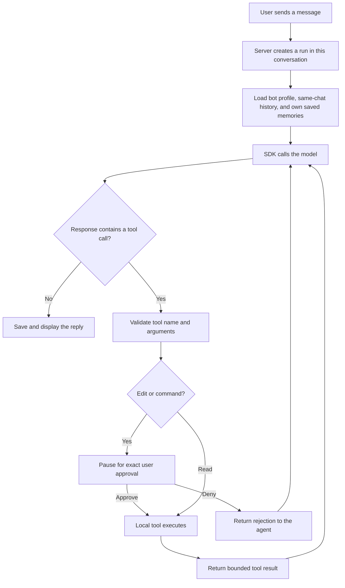

# How Tinkerfleet works

Tinkerfleet is a personal agent app: a browser interface, a local Node server,
reusable bot profiles, and a model that can request tools. You can talk directly
to your primary agent or an ordinary bot. The primary can also bring other bots
into the work.

An LLM generates a response from the input you send it. The **agent loop** is the
application behavior around those responses: supplying instructions and context,
calling the model, checking a requested tool, running it, returning its result,
and asking the model what to do next. A bot's name and personality help shape its
responses; the server and SDK make that loop work.

## Follow one request

Suppose you ask the primary, “What version of Node.js is installed?” With local
tools enabled, the flow is:



The model might request the `run_command` tool with these arguments:

```json
{"executable":"node","args":["--version"],"cwd":null}
```

That JSON is a proposed function call. The model has not launched Node. The
local server validates the proposal and shows an approval card. After approval,
the native runner launches the resolved executable with those exact arguments.
Its result goes back to the model, which can explain the version it actually
observed. `cwd: null` means the selected workspace. If the model sends an
absolute working directory inside that workspace, Tinkerfleet's own
`normalizeCommandCwd` in [sdk/actions.ts](../src/server/sdk/actions.ts) turns it into the
matching relative path. This is app code, not an Agents SDK feature.

Start reading at `startRun` in [app.ts](../src/server/app.ts), then
`createSdkAdapter` in [sdk/adapter.ts](../src/server/sdk/adapter.ts). The executable work lives in
[native-runner.ts](../src/server/native-runner.ts), not in the browser or the model.

A [schedule](capabilities.md#scheduled-runs) enters the same flow at step A without you: in
live mode, `runDueSchedules` in [app.ts](../src/server/app.ts) calls `startRun` with the saved
prompt in the bot's own chat. Everything after that is identical, including the pause for
approval. [schedules.ts](../src/server/schedules.ts) decides when one is due.

## A bot, a conversation, and a run are different things

A bot profile is a reusable identity. A conversation is one chat with the
participants it captured. A run is one submitted request and all the work it
triggers, possibly several model calls. The
[build guide's table](build-an-agent-app.md#2-build-the-chat-before-adding-autonomy)
compares the three with examples.

A bot's persistent identity is its profile `id`, not its display name. Two bots
named Ada can have different IDs and different memories. Existing conversations
keep their captured profiles; editing the library affects new conversations.
Saved memory follows the ID even when a profile's personality changes.

Each bot's profile chooses its capabilities: `web`, `read`, `edit`, `run`, and
`memory`. `createFleetAgents` gives an agent a group's tools only when the profile
asks for it and the server enables it; see
[capability rules](../src/shared/capabilities.ts). Before each run the server also
applies the library's current capabilities, so granting or removing one reaches
conversations that captured an older copy (their names and purposes stay as captured). Roles are not permission classes. Older `scout`,
`maker`, and `checker` role values remain compatible profile data. The primary's
special ability is coordination. Internally its SDK agent and message author
are named `coordinator`; its saved profile ID still determines its memory owner.
See [shared types](../src/shared/types.ts) and [profile validation](../src/server/personas.ts).

## Two ways the primary coordinates

In a direct primary conversation, `create_agent({name, purpose})` saves a reusable
ordinary bot and opens its direct conversation. Creation does not run that bot.
The primary can then choose either of these paths:

| Path | What starts | How the primary receives the result |
| --- | --- | --- |
| `message_agent({agentId, message})` | A separate run in that bot's direct conversation | The server relays a labeled reply or status into the source chat; the primary can read it on its next turn |
| `start_group_conversation({title, brief, botIds})` | A separate group conversation and run | Inside the group, its primary can call selected bots through SDK `asTool` tools and use their results before finishing its reply |

Individual messaging is asynchronous. Its tool result confirms the recipient
conversation and identity, not a finished answer. A recipient can be awaiting
approval, complete, fail, or be stopped. Relaying that status does not
automatically call the primary model again. A later user message starts the next
primary turn. See `messageAgent` and `relayAgentReplies` in [app.ts](../src/server/app.ts).

Group delegation works within the group's run. `createFleetAgents` in
[sdk/fleet.ts](../src/server/sdk/fleet.ts) exposes an `ask_*` tool for each selected ordinary
bot, using SDK `agent.asTool(...)`. The primary supplies a self-contained request;
the selected bot uses its own instructions and tools, then returns a result to
the primary. These nested calls share the group's token, call-count, and runtime
budgets. A nested edit or command can pause the group for approval.

Both coordination paths share an explicit brief, rather than automatically
copying the source chat's private history. The recipient's own chat history and
memories can still apply. A new group starts fresh history. Its child run has
separate budgets and a separate stop control from the originating direct run.
Stopping the source does not stop an already-created child.

Each primary run can create only a few bots, send only a few messages, and
start one group. Groups and the bot library have size caps. The numbers are in
[Limits](capabilities.md#limits). Only a direct primary gets creation, messaging,
and group-start tools. A group primary gets its selected `ask_*` tools; ordinary
bots cannot recursively create more collaborations.
The adapter also supports groups without a primary by running each selected bot
sequentially, sharing earlier replies from that run.

## Context has three separate lifetimes

| Context | Scope and lifetime | Implementation |
| --- | --- | --- |
| Conversation history | Recent messages from this chat, persisted across restarts | [conversations.ts](../src/server/conversations.ts) |
| Saved memory | Explicit notes belonging to one profile ID, reused across its chats | [memory.ts](../src/server/memory.ts) and [memory guide](memory.md) |
| SDK `RunState` | Current loop, tool results, and approval interruptions; held in server memory | [sdk/adapter.ts](../src/server/sdk/adapter.ts) |
| Trace | A bounded, redacted summary of each model call's request and reply; server memory only, never saved | [sdk/trace.ts](../src/server/sdk/trace.ts) and [Reading a trace](traces.md) |

The server selects history from the current conversation. The SDK adapter builds
a bounded recent-history context from it; [Limits](capabilities.md#limits) gives
the size. Outgoing context management also shortens long tool output and removes
older exchanges while preserving required tool-call/result pairs. It does not
rewrite approval arguments. See
[context-budget.ts](../src/server/context-budget.ts).

Saved memory is loaded for each selected bot at run start and included only in
that bot's instructions. It is labeled context, not authority to override the
user or tool policy. There is no automatic transcript summary, global shared
memory, or vector database.

An approval pause retains the live SDK state so a decision can resume the exact
interrupted loop. Browser reload can reconnect while the server is running.
Server restart preserves saved messages and memories, but cancels unfinished
runs and denies outstanding approvals; raw SDK state and execution grants are
not persisted.

## Where tools run

Local tools are enabled with `TINKERFLEET_WORKSPACE_TOOLS=1`. With them off, bots
can still converse, use memory, coordinate, and use enabled hosted search, but
cannot read or change local files through workspace tools.

`list_files` and `read_file` inspect the selected workspace. `edit_file` and
`run_command` require exact, single-use approval. The SDK interruption supplies
the pause; Tinkerfleet's [approval store](../src/server/approval.ts) binds the
reviewed action to execution. See [approvals](approvals.md) for the full flow.

Approved native commands run with the host user's permissions, so the selected
folder does not confine them. An explicit command can use user-requested
absolute paths, and cancellation does not undo completed effects. The
runner supplies bounded output, command timeouts, and a minimal environment.
See [local workspace tools](workspace.md) for paths and command behavior.

Hosted `webSearchTool` runs through the Responses API, separately from local
commands. Live mode enables it unless `TINKERFLEET_WEB_SEARCH=0`; supported models
can also open public pages and find text in them. It does not control a signed-in
browser. The UI displays observed search activity and validated source links.
Web pages and tool output remain untrusted input to the agent.

## What the SDK supplies, and what this app supplies

The **Responses API** is the remote model interface used here. The **Agents SDK**
is the local `@openai/agents` library that manages repeated calls, tools,
agent-as-tool delegation, and approval interruptions. Tinkerfleet supplies the
UI, persistence, profiles, memory ownership, execution policy, and approval
binding. This app does not use a managed hosted agent service or its session
storage. Installing the SDK does not deploy the app anywhere.

The browser displays saved messages, activity, sources, and approval choices;
the server keeps the API key and runs the implementations. Demo mode swaps only
the model: [a scripted `DemoModel`](../src/server/demo.ts) implements the SDK's
`Model` interface, so the demo runs the actual SDK loop, tools, and approvals
against a temporary copy of tiny-project without an API call.

Turn and model-call counts default to unlimited (`0` in configuration, `null`
for SDK `maxTurns`). Token, response-size, runtime, and tool limits still apply.
A run can therefore stop without a count cutoff, and a new follow-up gets a fresh
run budget. These are resource bounds, not a precise dollar cap. See
[setup](setup.md) for configuration.
