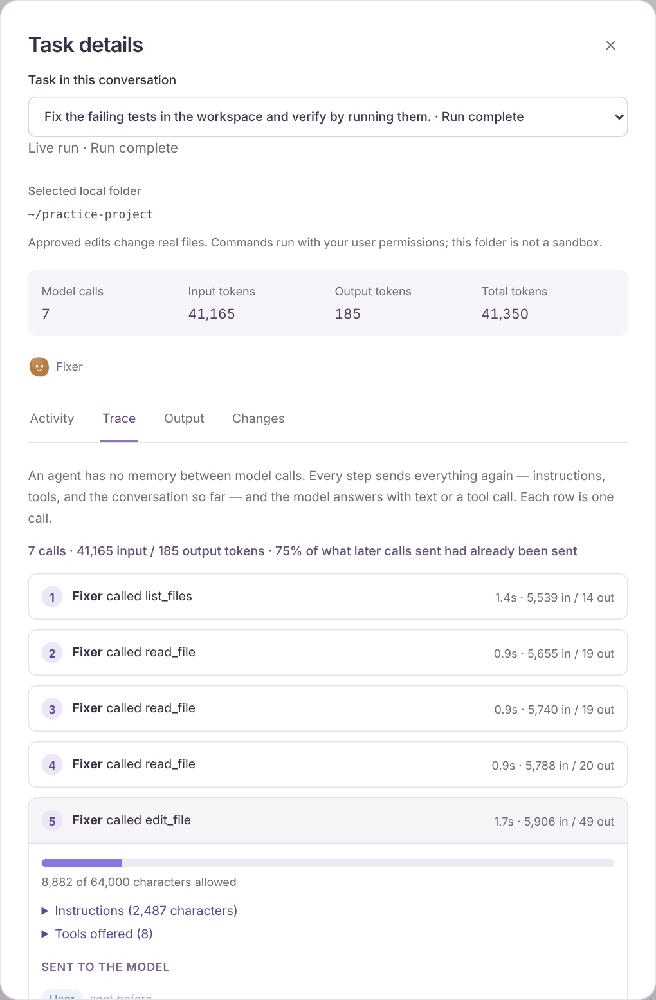

# Reading a trace

A **trace** is the record of what each model call in a run sent and what came back. It is the quickest way to see how an agent really works, because the model you are talking to never remembers anything between calls. Every step of the loop sends the whole request again.

Open any task, choose **Task details**, then the **Trace** tab. Demo runs have traces too, so you can learn this without an API key.

The capture is from a real run of a small model. It lists seven calls for a task that asked to fix a failing test, with call 5, the edit, expanded. The folder name is replaced.

## What each part shows

Each row is one model call. The row says which agent made it and what the model did with the request: it replied, or it asked for one or more tools. Expand a row to see:

- **The context meter.** How much of the request budget the call used, and what Tinkerfleet did to make it fit: older items dropped, long tool output shortened. The budget is `maxInputChars`; see [Limits](capabilities.md#limits).
- **Instructions.** The system prompt for that agent: its personality, rules, and saved memories.
- **Tools offered.** The names, descriptions, and argument names the model could choose from. The model sees only these, never your tool's code.
- **Sent to the model.** The conversation as that call received it. Items the same agent's previous call had not already sent are marked **new**; the rest are dimmed **sent before**.
- **The model replied.** Text, or the tool calls it asked for with their arguments.

## What to look for

1. **The model starts from nothing every time.** In the second call, the first call's whole request is back, plus the tool call and its result. The summary line gives the share of items that were re-sent. This is why long tasks cost more per step as they go.
2. **Your message is a small part of the request.** The instructions and tool definitions go with every call. In the capture, the first call's input is about 5,500 tokens for one short message.
3. **The window has a budget.** A long tool result is shortened before it is sent again, and older exchanges are removed when the request is still too large. The trace shows what the model received, which can differ from what your code returned.
4. **Tool calls are only requests.** A call such as `edit_file` appears here as the model asking. Whether it happens is decided by your [approval](approvals.md), not by the model.
5. **Failures are visible.** A call that failed shows a fixed, safe message in place of a reply, without any provider detail.

When an agent coordinates others, calls from each agent in the same run appear in order, labelled by agent. Work in another conversation, such as a bot you messaged, has its own run and its own trace.

## What a trace is not

A trace is a bounded summary, held for readers, not a recording.

- **It lives in server memory only.** Nothing is written to disk, so it is gone when the server restarts. The run itself stays in your history; its Trace tab says there is no trace.
- **It never contains model reasoning.** A reasoning item is counted and labelled hidden, not copied.
- **Credentials are redacted** with the same patterns as the rest of the app, before any text is shortened.
- **Long text is shortened,** and the viewer says how much was cut. The limits are in [Limits](capabilities.md#limits).
- **It is the data your own browser session already sends and receives,** and the endpoint requires the same session as the rest of the API. Treat a trace like a conversation: it can include file contents and command output.

## How it works

[`sdk/model.ts`](../src/server/sdk/model.ts) wraps the real model, so every call passes through one function. That function trims the request, calls the model, and hands what it sent and received to [`sdk/trace.ts`](../src/server/sdk/trace.ts), which summarizes it and keeps it in a bounded `TraceStore`. Recording can never change the run: a failure while recording is ignored. The browser reads a run's trace from `GET /api/conversations/:id/runs/:runId/trace`, and [`trace-view.tsx`](../src/client/trace-view.tsx) draws it.

Run [lesson 10](../lessons/README.md#10-read-a-trace) to produce a trace from code, then try the exercises there.

## Try it

- Ask a bot to read a file, then find the tool result in the next call. Is it the whole file?
- Compare a one-line question with a task that uses tools. How does the share of re-sent items change?
- Lower `TINKERFLEET_MAX_TOTAL_TOKENS` and watch where a run stops. Which call was the last one?
